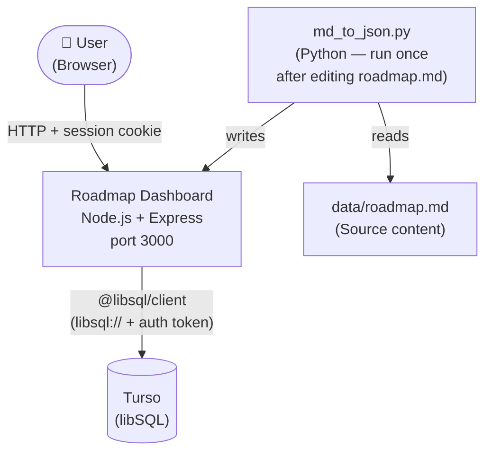
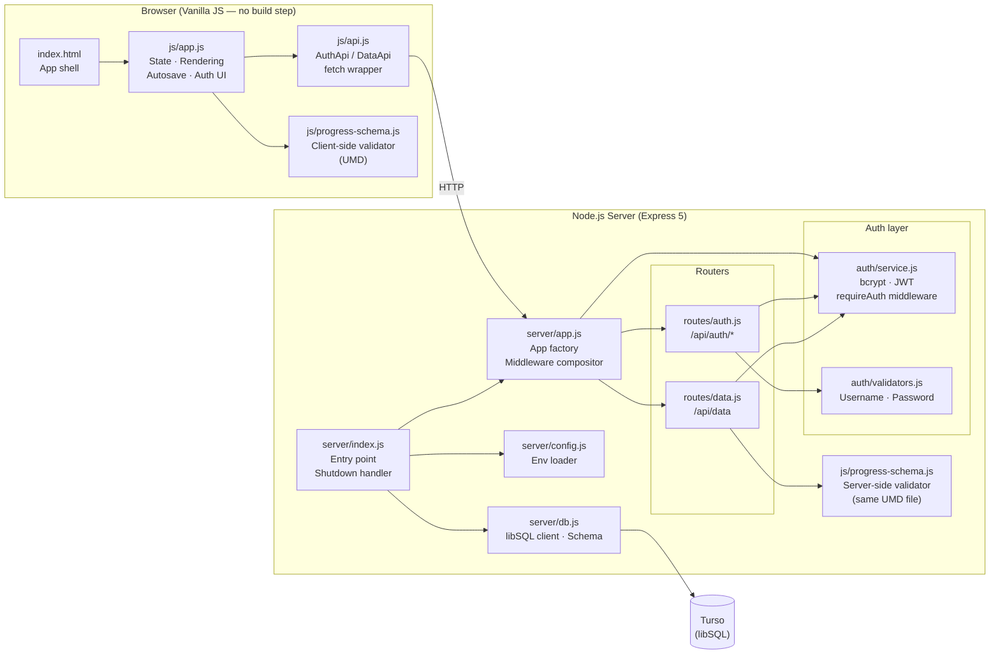
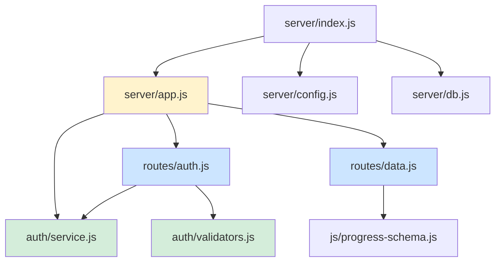
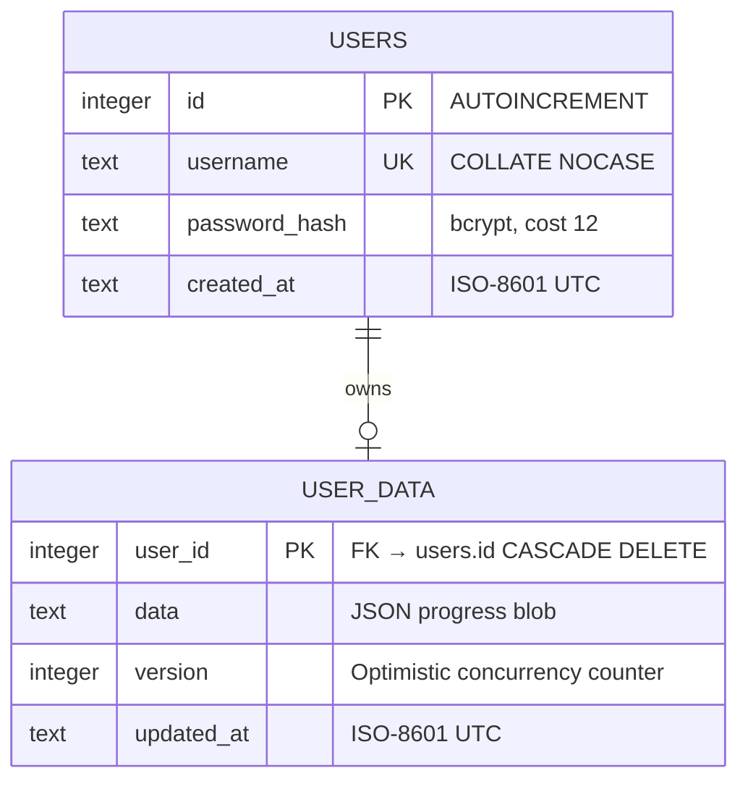
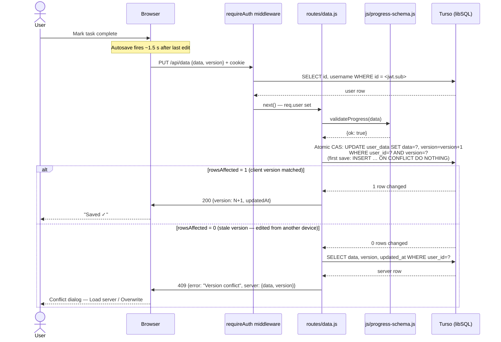
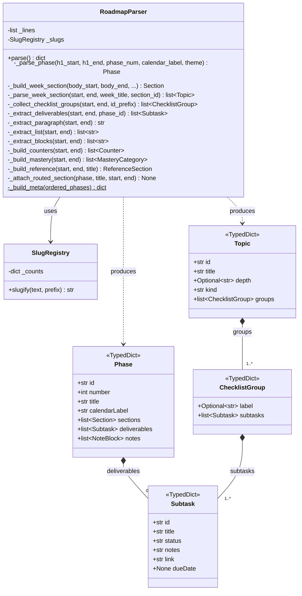

# AI Engineer Roadmap — Progress Dashboard

A single-page web application that converts `data/roadmap.md` (a structured 10-month Tier-1 AI Engineer career roadmap) into an interactive, multi-user progress tracker. Each user registers an account; progress is persisted per-user in [Turso](https://turso.tech) (hosted libSQL/SQLite) so the same state is visible from any device.

---

## Table of Contents

1. [Features](#features)
2. [Screenshots](#screenshots)
3. [Tech Stack](#tech-stack)
4. [Requirements](#requirements)
5. [Quick Start](#quick-start)
6. [Project Structure](#project-structure)
7. [Architecture & UML](#architecture--uml)
   - [System Context](#system-context)
   - [Component Diagram](#component-diagram)
   - [Module Dependency Graph](#module-dependency-graph)
   - [Database Schema](#database-schema-er-diagram)
   - [Auth Flow](#auth-flow--sequence-diagram)
   - [Data Save Flow](#data-save-flow--sequence-diagram)
   - [Python Parser Class Diagram](#python-parser-class-diagram)
8. [Configuration](#configuration)
9. [API Reference](#api-reference)
10. [Security](#security)
11. [Data Model](#data-model)
12. [Running Tests](#running-tests)
13. [Updating Roadmap Content](#updating-roadmap-content)
14. [Deploying to Production](#deploying-to-production)
15. [Code Architecture & Design Principles](#code-architecture--design-principles)
16. [Browser Support](#browser-support)

---

## Features

| View | Description |
|---|---|
| **Overview** | Overall completion %, per-month progress bars, pace projection, weekly momentum chart, interview/career counters |
| **Timeline** | Month → Week → Topic → Task drill-down; exit criteria, deliverables, read-only background notes |
| **Kanban** | Per-month drag-and-drop board across To Do / In Progress / Blocked / Done |
| **Checklist** | Full flat task list with status/phase filters, search, and a per-task details modal (notes, link, due date) |
| **This Week** | Active tasks for the current week, overdue tasks, and tasks due in the next 7 days |
| **Skills Checklist** | Flat mastery checklist trackable independently of the calendar |
| **Reference** | All strategic/background roadmap content, searchable |

Additional capabilities:
- **Custom content** — add topics to any week, or add entirely new months with their own sections and topics; custom items appear everywhere built-in items do
- **Autosave** with optimistic-concurrency conflict detection (multi-device support)
- **Export / Import** progress as JSON
- **Dark mode**, search, and a reset with confirmation
- **Celebration** (confetti) when all tasks in a month are completed

---

## Screenshots

> **How to add your URLs:** open a [new GitHub Issue](../../issues/new), drag each image file into the text box, wait for the upload to finish, then copy the generated URL (format: `https://github.com/<owner>/<repo>/assets/…`). Paste each one in place of the placeholder below and close the issue without submitting it.

### Login


### Dashboard (Home)


### Timeline


---

## Tech Stack

| Layer | Technology |
|---|---|
| Frontend | Plain HTML5, CSS3, Vanilla JS (ES2022) — no build step, no framework |
| Backend | Node.js 22+, Express 5 |
| Auth | `bcryptjs` (password hashing), `jsonwebtoken` (signed session cookies) |
| Database | Turso (hosted libSQL, SQLite-compatible) via `@libsql/client` — async API |
| Security middleware | `helmet`, `express-rate-limit`, `cookie-parser` |
| Roadmap parser | Python 3.10+ — `scripts/md_to_json.py` converts Markdown to JSON |
| Testing | Node.js built-in `node:test` (no extra test runner) |
| Process | `dotenv` for local env, `cross-env` for cross-platform `NODE_ENV` |

---

## Requirements

| Requirement | Version |
|---|---|
| Node.js | ≥ 22 (`engines` in `package.json`) |
| Turso database | Required in production (free tier is plenty); optional in development |
| npm | ≥ 10 (bundled with Node 22) |
| Python | ≥ 3.10 (only needed to regenerate roadmap data from Markdown) |

> **Python is optional for day-to-day use.** The pre-built `data/roadmap.json` and `data/roadmap.js` are committed; Python is only needed when you edit `data/roadmap.md`.

---

## Quick Start

### Development

```bash
# 1. Clone / enter the directory
cd roadmap-dashboard

# 2. Install dependencies
npm install

# 3. (Optional) set a stable session secret so logins survive restarts
cp .env.example .env
# edit .env and set SESSION_SECRET

# 4. Start the dev server with auto-restart on changes
npm run dev
# → http://localhost:3000
```

Without `TURSO_DATABASE_URL`, development uses a local SQLite file at `data/app.db` (git-ignored), so no Turso account is needed to get started. To develop against your Turso database instead, set `TURSO_DATABASE_URL` and `TURSO_AUTH_TOKEN` in `.env` (see [Setting up Turso](#setting-up-turso)).

Open http://localhost:3000, choose **Create an account**, and start tracking. Express serves both the API and the static frontend from one process — no separate dev server, no proxy, no CORS to configure.

### Run Tests

```bash
npm test
```

All 41 tests cover auth flows, data save/load, conflict detection, cross-user isolation, rate limiting, schema validation, and static-file security.

### Regenerate Roadmap Data

Run this whenever `data/roadmap.md` is edited:

```bash
python3 scripts/md_to_json.py
# → Overwrites data/roadmap.json and data/roadmap.js
```

---

## Project Structure

```
roadmap-dashboard/
│
├── index.html                    App shell + login screen
├── css/
│   └── styles.css                All styling (light + dark themes)
│
├── js/
│   ├── app.js                    UI state, rendering, autosave, auth
│   ├── api.js                    HTTP client (AuthApi, DataApi, window.Api shim)
│   └── progress-schema.js        Progress data validator (UMD — browser + server)
│
├── server/
│   ├── index.js                  Entry point: loads config, connects to DB, starts server
│   ├── app.js                    Express app factory (thin compositor)
│   ├── config.js                 Env-var loader with fast-fail production validation
│   ├── db.js                     Turso/libSQL connect + schema (SCHEMA_STATEMENTS)
│   ├── auth/
│   │   ├── service.js            Pure auth helpers: bcrypt, JWT, cookie options
│   │   └── validators.js         Input validators: username, password
│   └── routes/
│       ├── auth.js               Router: /api/auth/register|login|logout|me
│       └── data.js               Router: GET|PUT /api/data (atomic CAS)
│
├── scripts/
│   └── md_to_json.py             Markdown → JSON/JS pipeline (RoadmapParser class)
│
├── test/
│   ├── helpers.js                Server bootstrap, cookie-jar client, fixtures
│   ├── api.test.js               Integration tests: auth, data, conflicts, isolation
│   ├── config.test.js            Unit tests for config loader
│   └── schema.test.js            Unit tests for progress-schema validator
│
├── data/
│   ├── roadmap.md                Source roadmap (edit this)
│   ├── roadmap.json              Generated structured data
│   ├── roadmap.js                Generated JS wrapper (window.ROADMAP_DATA)
│   ├── schema.md                 JSON shape reference
│   └── app.db                    Local dev fallback DB only (created when TURSO_DATABASE_URL is unset; git-ignored)
│
├── .env.example                  Configuration template
├── render.yaml                   Render web-service blueprint (Turso env vars, no disk)
└── package.json
```

---

## Architecture & UML

### System Context



> The Python script is a one-shot offline tool. The running server reads only the generated `data/roadmap.js` file; the database holds per-user progress.

---

### Component Diagram



---

### Module Dependency Graph



> Green = auth layer (no Express dependency), Blue = routers, Yellow = app compositor.

---

### Database Schema (ER Diagram)



One row in `user_data` per user. The `data` column stores the full progress JSON blob validated by `progress-schema.js` before every write. `version` implements compare-and-swap to prevent lost updates across devices.

---

### Auth Flow — Sequence Diagram

```mermaid
sequenceDiagram
    actor U  as User
    participant B  as Browser
    participant AR as routes/auth.js
    participant SV as auth/service.js
    participant VA as auth/validators.js
    participant DB as Turso (libSQL)

    Note over U,DB: Registration
    U  ->> B:  Enter username + password
    B  ->> AR: POST /api/auth/register {username, password}
    AR ->> VA: validateUsername(username)
    AR ->> VA: validatePassword(password)
    VA -->> AR: {valid: true}
    AR ->> SV: hashPassword(password, cost=12)
    SV -->> AR: bcrypt hash
    AR ->> DB: INSERT INTO users (username, hash)
    DB -->> AR: lastInsertRowid
    AR ->> SV: signToken(user, secret, 7d)
    SV -->> AR: JWT
    AR ->> B:  201 + Set-Cookie: rd_session=<JWT>; HttpOnly; SameSite=Lax
    B  -->> U: Logged in ✓

    Note over U,DB: Subsequent request (rolling session)
    B  ->> AR: GET /api/auth/me (cookie sent)
    AR ->> SV: await getCurrentUser(req, db, secret)
    SV ->> DB: SELECT id, username WHERE id = <sub>
    DB -->> SV: user row
    AR ->> SV: signToken(user, …)  [renew]
    AR ->> B:  200 {user} + refreshed cookie
```

---

### Data Save Flow — Sequence Diagram



---

### Python Parser Class Diagram



---

## Configuration

Copy `.env.example` to `.env` (git-ignored) and fill in the values:

```bash
cp .env.example .env
```

| Variable | Default | Description |
|---|---|---|
| `SESSION_SECRET` | Random (dev only) | Signs session JWTs. **Required in production** (≥ 32 chars). Generate: `node -e "console.log(require('crypto').randomBytes(48).toString('hex'))"` |
| `TURSO_DATABASE_URL` | Local file `data/app.db` (dev only) | Turso database URL (`libsql://<db>-<org>.turso.io`). **Required in production.** Also accepts `file:…` or `:memory:` (tests use `:memory:`). |
| `TURSO_AUTH_TOKEN` | — | Turso auth token. **Required in production when the URL is remote** (`libsql://`, `https://`, `wss://`); not needed for local `file:`/`:memory:` targets. |
| `PORT` | `3000` | HTTP port the server listens on. |
| `TRUST_PROXY` | off | Set to `1` when behind a single reverse proxy so rate limiting sees real client IPs. |
| `COOKIE_SECURE` | `true` in production | Session cookie `Secure` flag. Set `false` **only** for plain-HTTP production setups (e.g. a LAN box). |
| `NODE_ENV` | — | Set to `production` to enable strict secret/database validation and secure cookies. |

> `DB_PATH` no longer exists. Production fails fast at startup if `SESSION_SECRET` or `TURSO_DATABASE_URL` (or the token for a remote URL) is missing.

---

## API Reference

All endpoints return and accept JSON. Sessions are managed via an httpOnly `SameSite=Lax` cookie.

### Auth endpoints — `/api/auth`

| Method | Path | Request body | Response |
|---|---|---|---|
| `POST` | `/api/auth/register` | `{username, password}` | `201 {user}` · `400` validation error · `409` username taken |
| `POST` | `/api/auth/login` | `{username, password}` | `200 {user}` · `401 Invalid credentials` |
| `POST` | `/api/auth/logout` | — | `204` (clears cookie) |
| `GET` | `/api/auth/me` | — | `200 {user}` (renews session) · `401` |

**Rate limits:** 10 requests per 15 minutes per IP. Only **failed** logins count toward the login limit.  
**Username rules:** 3–32 characters — letters, digits, `_`, `-`. Case-insensitive uniqueness; original casing preserved.  
**Password rules:** 8–72 bytes UTF-8 (bcrypt limit).

### Data endpoints — `/api/data`

| Method | Path | Request body | Response |
|---|---|---|---|
| `GET` | `/api/data` | — | `200 {data, version, updatedAt}` · `{data:null, version:0}` for new users |
| `PUT` | `/api/data` | `{data, version}` | `200 {version, updatedAt}` · `400` schema error · `409` version conflict · `413` body > 5 MB |

The `PUT` endpoint uses **compare-and-swap** in a single atomic statement (`UPDATE … WHERE user_id = ? AND version = ?`, or `INSERT … ON CONFLICT DO NOTHING` for a first save with `version: 0`). If no row changes because the server's current version differs from `version` in the request, the server row is read and a `409` is returned with it so the client can resolve the conflict.

### Static files served

`/`, `/index.html`, `/css/*`, `/js/*`, `/data/roadmap.js`

Everything else (database, `.env`, server source, `package.json`, `node_modules`) returns `404`.

---

## Security

| Concern | Approach |
|---|---|
| Password storage | bcrypt, cost 12. A pre-computed dummy hash is compared for unknown usernames so response timing doesn't reveal which usernames are registered. |
| Sessions | HS256 JWT (7-day rolling window) in an `httpOnly`, `SameSite=Lax` cookie. Renewed on every `/api/auth/me` call. |
| CSRF | `SameSite=Lax` cookie + JSON-only endpoints (no HTML form POSTs accepted). |
| Rate limiting | `express-rate-limit`: 10 auth attempts per 15-minute window. Successful logins are excluded from the login counter. |
| HTTP headers | `helmet` sets `X-Content-Type-Options`, `X-Frame-Options`, `X-DNS-Prefetch-Control`, `Referrer-Policy`, etc. `X-Powered-By` is removed. |
| API cacheability | All `/api` responses carry `Cache-Control: no-store`. |
| Input validation | Username regex + password length checked before any DB call. Progress data validated against the schema before every write. |
| Database credentials | `TURSO_AUTH_TOKEN` lives only in environment variables (`.env` is git-ignored; `sync: false` in `render.yaml` keeps it out of the repo). |
| SQL injection | All queries are parameterised via `db.execute({ sql, args })` (`@libsql/client`); values are never interpolated into SQL. User data queries are always scoped by session user id, never by request body. |
| Static allowlist | Only four path patterns serve files; `path.join` + `sendFile` prevent path-traversal. |

**Not included by design:** password reset, email verification, 2FA, account deletion UI, admin interface, JWT revocation.

---

## Data Model

The roadmap data (generated from Markdown) and the user progress data are **completely separate**:

```
Roadmap (data/roadmap.json — generated, read-only)
├─ meta            Title, horizon dates, weekly-hours targets, depth levels
├─ phases[]        10 calendar months
│   ├─ sections[]  Week blocks (Months 1–8) or thematic sections (Months 9–10)
│   │   └─ topics[] → groups[] → subtasks[]    Checkbox items
│   ├─ deliverables[]   Month-level deliverable checklist
│   └─ notes[]          Checkbox-free background content (read-only)
├─ counters[]      Cross-cutting running totals (DSA problems, system designs, …)
├─ masteryChecklist[]   Flat skills checklist, by category
└─ reference[]     Strategic/background sections
```

```
Progress (Turso user_data.data — per-user, server-persisted)
├─ items{}         { [taskId]: { status, notes, link, dueDate, completedAt } }
├─ counters{}      { [counterId]: currentValue }
├─ celebratedPhases[]   Phase IDs where the completion celebration has fired
├─ settings{}      { startMonth: "YYYY-MM" }
└─ custom{}        User-added topics and months
    ├─ topics[]    { id, sectionId, title, depth, tasks[] }
    └─ phases[]    { id, title, objective, sections[] }
```

See `data/schema.md` for the complete shape with all fields.

---

## Running Tests

```bash
npm test
```

The test suite uses Node's built-in `node:test` runner — no Jest, no Mocha. Each test boots a real HTTP server on an ephemeral port backed by an in-memory libSQL database (`:memory:`), so tests are fully isolated, fast, and require no mocking.

| Test file | Coverage |
|---|---|
| `test/api.test.js` | Auth flows, data round-trips, version conflicts, cross-user isolation, rate limiting, static-file security |
| `test/config.test.js` | Config loader — env vars, production guards, defaults |
| `test/schema.test.js` | Progress schema validator — valid/invalid shapes, `__proto__` injection, custom months |

---

## Updating Roadmap Content

1. Edit `data/roadmap.md` (keep the existing heading conventions).
2. Regenerate the data files:
   ```bash
   python3 scripts/md_to_json.py
   ```
3. Refresh the app. Saved progress is **not affected** — it overlays the roadmap by item ID.

> **Caution:** Renaming a task's heading changes its slug ID, making it appear as a new task. Editing the description/resources without renaming is always safe.

The parser (`RoadmapParser` class in `scripts/md_to_json.py`) handles:

| Heading convention | Parsed as |
|---|---|
| `# N. MONTH N — LABEL` + unnumbered H1 | Phase with theme title |
| `## Month Objective` | `phase.objective` |
| `## Exit Criteria` | `phase.exitCriteria[]` |
| `## Week N — Title` | Week section |
| `### Topic Title — D2` | Topic with depth suffix |
| `### Build` / `### Benchmark` | Topic with kind override |
| `- [ ] Task` | Subtask |
| `Label:` before checklist items | Group label |
| `### Month N deliverables` | `phase.deliverables[]` |
| H2 with no checkboxes | Read-only note |

Sections not matching a `## Week N` pattern in Months 9–10 are routed to their phase via the `SECTION_ROUTING` table in the script.

---

## Deploying to Production

The server is a long-running Node.js process, so static hosts (GitHub Pages, Netlify, Vercel static) cannot run it; use any Node host (Render, Fly.io, Railway, a VPS, a home server). All data lives in **Turso**, not on the host's disk, so **no persistent disk or volume is needed** — redeploying or replacing the host keeps every user and their progress.

### Setting up Turso

```bash
# Install the CLI (macOS/Linux; on Windows: winget install turso)
curl -sSfL https://get.tur.so/install.sh | bash

turso auth login
turso db create roadmap-dashboard
turso db show roadmap-dashboard --url          # → TURSO_DATABASE_URL (libsql://…)
turso db tokens create roadmap-dashboard       # → TURSO_AUTH_TOKEN (keep secret)
```

The schema (`users`, `user_data`) is created automatically on first start (`CREATE TABLE IF NOT EXISTS`).

### Running anywhere

```bash
# Install production dependencies only
npm ci --omit=dev

# Set environment variables (or use a .env file)
export NODE_ENV=production
export SESSION_SECRET="$(node -e "console.log(require('crypto').randomBytes(48).toString('hex'))")"
export TURSO_DATABASE_URL="libsql://<db>-<org>.turso.io"
export TURSO_AUTH_TOKEN="<token>"
export PORT=3000
export TRUST_PROXY=1                     # if behind a reverse proxy

npm start
```

### Deploying to Render

`render.yaml` in the repo defines the web service (Node 22.x, `npm install`, `npm start`, `TRUST_PROXY=1`, a generated `SESSION_SECRET`). It declares no disk.

1. Push the repo to GitHub and create a Render **Web Service** (or Blueprint) from it.
2. In the service's **Environment** tab set `TURSO_DATABASE_URL` and `TURSO_AUTH_TOKEN` (declared with `sync: false`, so Render never reads them from the repo and you enter them in the dashboard).
3. Make sure `SESSION_SECRET` is set. `generateValue: true` in `render.yaml` only applies when Render creates the service from the blueprint; for a service created earlier, set it manually.
4. Remove any old `DB_PATH` variable, and detach the old persistent disk if you added one.
5. Deploy. Register a user, redeploy, and confirm you can still log in.

### Production checklist

1. **HTTPS** — Run behind a TLS-terminating reverse proxy (Caddy, nginx, Traefik). Production cookies are `Secure`; login won't work over plain HTTP unless you set `COOKIE_SECURE=false`.

   Minimal Caddy config:
   ```
   roadmap.example.com {
       reverse_proxy localhost:3000
   }
   ```

2. **Database** — Persistence is handled by Turso; the host needs no volume. The old "one server process per database file" restriction no longer applies, since Turso handles concurrent connections. Keep `TURSO_AUTH_TOKEN` in a secrets store; rotate it with `turso db tokens create` if it leaks.

3. **Backups** — Dump the database to SQL on a schedule and copy it off-machine:
   ```bash
   turso db shell roadmap-dashboard .dump > backup-$(date +%F).sql
   ```
   Restore into a new database with `turso db create <new-name> --from-dump backup-YYYY-MM-DD.sql`. Check your Turso plan for built-in point-in-time recovery limits.

4. **Stable `SESSION_SECRET`** — Changing it logs out every user. Store it in a secrets manager or a secure env-var store, not in the repository.

5. **Process manager** — Run under systemd, Docker, or pm2 so the server restarts on failure. It shuts down cleanly on `SIGINT`/`SIGTERM` (drains in-flight requests and closes the database client).

---

## Code Architecture & Design Principles

The codebase follows **SOLID** principles throughout:

### Single Responsibility

| Module | One responsibility |
|---|---|
| `auth/service.js` | bcrypt and JWT operations — no Express |
| `auth/validators.js` | Input validation rules — no DB access |
| `routes/auth.js` | HTTP auth route handlers |
| `routes/data.js` | HTTP data route handlers |
| `server/app.js` | Compose middleware and routers — no business logic |
| `server/config.js` | Parse and validate environment variables |
| `server/db.js` | Connect to Turso/libSQL, apply schema |
| `RoadmapParser` | Parse Markdown into structured data |
| `SlugRegistry` | Generate unique kebab-case IDs |

### Open/Closed

- **`validateProgress`** is open for new top-level keys: add a per-section validator function and one call in `validateProgress` — existing validators are untouched.
- **Route mounting** in `app.js` is open for new routers: add `app.use("/api/new", createNewRouter(...))` without modifying any existing router.

### Dependency Inversion

- `auth/service.js` wraps `bcryptjs` and `jsonwebtoken` so route handlers (`routes/auth.js`) depend on the wrapper, not the library.
- `createDataRouter` receives `requireAuth` as a parameter rather than importing it directly, making it testable with a substitute middleware.
- `RoadmapParser` accepts `list[str]` (lines) rather than a file path, separating I/O (`load_lines`) from parsing.

### Interface Segregation

- `js/api.js` exposes `AuthApi` (me, login, register, logout) and `DataApi` (getData, putData) as separate objects. Client code that only needs data sync does not depend on the auth surface. A combined `window.Api` shim is provided for backwards compatibility.

---

## Browser Support

Any modern evergreen browser: Chrome, Firefox, Safari, Edge. The app uses `fetch`, the HTML5 drag-and-drop API, and `<input type="date">`. No polyfills or transpilation.
